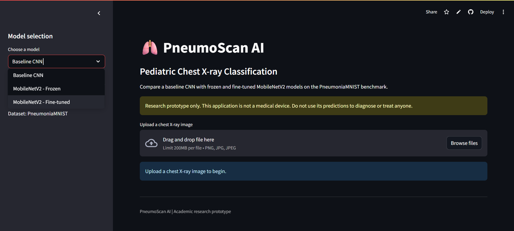
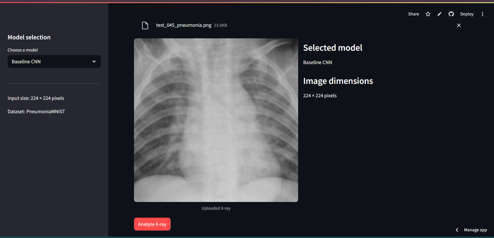
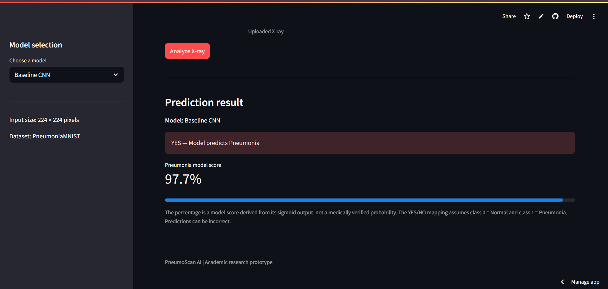
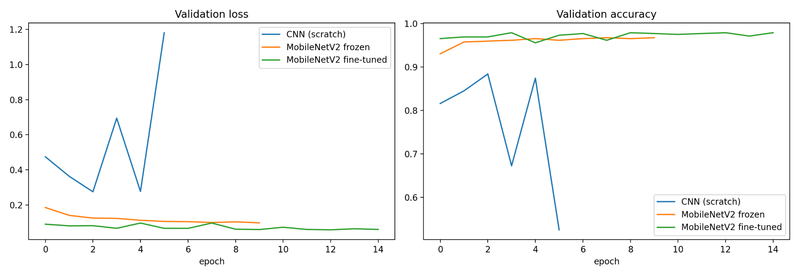
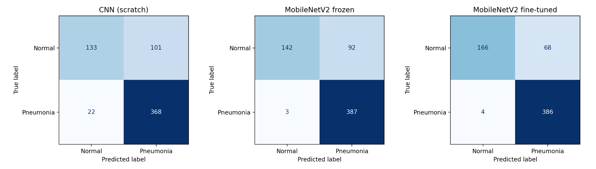
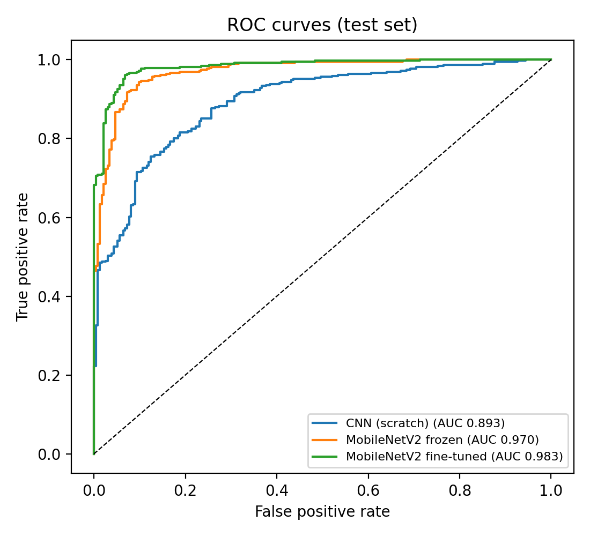

 <div align="center">


# 🫁 PneumoScan AI

### Pediatric Pneumonia Classification Using Deep Learning

**A comparative study of a Baseline CNN, Frozen MobileNetV2 and Fine-Tuned MobileNetV2**

<p>
  <a href="https://pneumoscan-ai-tnglamtsnsg4yd37q84jyw.streamlit.app/">
    
  </a>
</p>


</div>

---

## 📌 Table of Contents

- [Overview](#-overview)
- [Live Application](#-live-application)
- [Application Screenshots](#-application-screenshots)
- [Project Objectives](#-project-objectives)
- [Dataset](#-dataset)
- [Methodology](#-methodology)
- [Model Architectures](#-model-architectures)
- [Experimental Results](#-experimental-results)
- [Visual Results](#-visual-results)
- [Try with Sample X-ray Images](#-try-with-sample-x-ray-images)
- [Technology Stack](#-technology-stack)
- [Repository Structure](#-repository-structure)
- [Installation and Usage](#-installation-and-usage)
- [Research Documentation](#-research-documentation)
- [Limitations and Disclaimer](#-limitations-and-disclaimer)
- [Authors](#-authors)

---

## 🔍 Overview

**PneumoScan AI** is an academic deep learning project that explores the classification of pediatric chest X-ray images into two categories:

- **Normal**
- **Pneumonia**

The project investigates how transfer learning affects image classification performance by comparing a custom Convolutional Neural Network (CNN) with two MobileNetV2 approaches.

Three models are trained and evaluated under the same classification task:

1. Baseline CNN trained from scratch.
2. MobileNetV2 with frozen pretrained layers.
3. MobileNetV2 with fine-tuning.

The trained models are integrated into an interactive Streamlit web application. Users can upload a chest X-ray, select a model and view its classification output and model score.

The primary focus is **model development, comparative evaluation and practical deployment of deep learning models for medical image classification research.**

## 🚀 Live Application

Try the deployed application:

<p align="center">
  <a href="https://pneumoscan-ai-tnglamtsnsg4yd37q84jyw.streamlit.app/">
    
  </a>
</p>

**Live URL:**  
https://pneumoscan-ai-tnglamtsnsg4yd37q84jyw.streamlit.app/

The application allows users to:

- Select between three trained deep learning models.
- Upload a chest X-ray image.
- View the uploaded image and its dimensions.
- Run the selected model.
- View a Normal/Pneumonia classification output.
- Explore the model's pneumonia score.

## 🖥️ Application Screenshots

### 1. Application Dashboard

The main interface provides model selection and image-upload functionality.

<p align="center">
  
</p>

### 2. X-ray Image Upload

Users can upload a chest X-ray image and select the model they want to evaluate.

<p align="center">
  
</p>

### 3. Prediction Output

The application displays the selected model, classification result and corresponding model score.

<p align="center">
  
</p>

## 🎯 Project Objectives

- Develop a baseline CNN for pediatric chest X-ray classification.
- Apply transfer learning using pretrained MobileNetV2.
- Compare frozen feature extraction and fine-tuning approaches.
- Evaluate model performance using multiple classification metrics.
- Analyze confusion matrices and ROC curves.
- Deploy the trained models through an interactive web application.
- Provide an accessible research demonstration using sample X-ray images.

## 📊 Dataset

The project uses **PneumoniaMNIST**, part of the MedMNIST v2 benchmark collection.

The dataset contains 5,856 pediatric chest X-ray images divided into Normal and Pneumonia categories.

### Dataset distribution

| Dataset split | Normal | Pneumonia | Total |
|---|---:|---:|---:|
| Training | 1,214 | 3,494 | 4,708 |
| Validation | 135 | 389 | 524 |
| Testing | 234 | 390 | 624 |
| **Total** | **1,583** | **4,273** | **5,856** |

### Dataset characteristics

- Image type: Chest X-ray
- Image dimensions used: 224 × 224 pixels
- Image format: Grayscale
- Classification type: Binary
- Classes: Normal and Pneumonia

### Preprocessing

The image preprocessing pipeline includes:

- Resizing images to 224 × 224 pixels.
- Preparing image channels according to model input requirements.
- Applying data augmentation during training.
- Using class weights to address class imbalance.
- Preparing images using the respective model's input preprocessing.

## ⚙️ Methodology

The project follows a comparative deep learning workflow.

<p align="center">

```text
        PneumoniaMNIST Dataset
                  |
                  v
        Data Preprocessing
                  |
                  v
       Training / Validation
                  |
          +-------+-------+
          |       |       |
          v       v       v
       Baseline  Frozen  Fine-tuned
         CNN   MobileNet  MobileNet
          |       |       |
          +-------+-------+
                  |
                  v
          Model Evaluation
                  |
                  v
       Accuracy, Precision,
       Recall, F1, ROC-AUC
                  |
                  v
       Save Trained Models
                  |
                  v
        Streamlit Web App
                  |
                  v
        X-ray Classification
```

</p>

## 🧠 Model Architectures

Three deep learning approaches were implemented and compared.

### 1. Baseline CNN

A custom Convolutional Neural Network trained from scratch.

Its architecture consists of:

- Four convolutional blocks.
- Increasing feature channels: 32, 64, 128 and 128.
- Max pooling layers.
- Global Average Pooling.
- Dense layer with 128 units.
- Dropout regularization (0.5).
- Sigmoid output for binary classification.

### 2. MobileNetV2 — Frozen

A transfer learning approach using pretrained MobileNetV2.

- Uses ImageNet pretrained weights.
- Freezes the pretrained feature extraction layers.
- Trains a new classification head.
- Reuses learned visual features for pneumonia classification.

### 3. MobileNetV2 — Fine-Tuned

A transfer learning approach that further adapts selected pretrained layers.

- Starts from pretrained MobileNetV2 weights.
- Unfreezes selected layers for fine-tuning.
- Adapts pretrained features to the target dataset.
- Trains the classification head and selected base layers.

## 📈 Experimental Results

All three models were evaluated on the held-out test set using a classification threshold of 0.5.

### Test-set performance comparison

| Metric | Baseline CNN | MobileNetV2 Frozen | MobileNetV2 Fine-Tuned |
|---|---:|---:|---:|
| Accuracy | 80.3% | 84.8% | **88.5%** |
| Precision | 78.5% | 80.8% | **85.0%** |
| Recall | 94.4% | **99.2%** | 99.0% |
| Specificity | 56.8% | 60.7% | **70.9%** |
| F1-score | 85.7% | 89.1% | **91.5%** |
| ROC-AUC | 0.893 | 0.970 | **0.983** |

### Key findings

- Fine-tuned MobileNetV2 achieved the highest test accuracy of **88.5%**.
- Fine-tuned MobileNetV2 achieved the highest F1-score of **91.5%**.
- Fine-tuned MobileNetV2 achieved the highest ROC-AUC of **0.983**.
- Frozen MobileNetV2 achieved the highest recall of **99.2%**.
- Fine-tuned MobileNetV2 produced fewer false positives than the frozen model on the held-out test set.

Overall, fine-tuning improved the measured performance across several important metrics compared with the baseline CNN and frozen MobileNetV2.

## 📉 Visual Results

### 1. Validation Performance

Comparison of validation loss and validation accuracy across the three models.

<p align="center">
  
</p>

### 2. Confusion Matrices

The confusion matrices show the classification outcomes for Normal and Pneumonia images on the held-out test set.

<p align="center">
  
</p>

### 3. ROC Curves

ROC curves compare the discrimination performance of the three models.

<p align="center">
  
</p>

## 🩻 Try with Sample X-ray Images

Want to explore the application without finding your own X-ray images?

Download the sample collection containing:

- 25 Normal X-ray images.
- 25 Pneumonia X-ray images.
- A CSV file containing the reference labels.
- Instructions for using the samples.

<p align="center">
  <a href="docs/PneumoScan_AI_Sample_X-rays.zip">
    
  </a>
</p>

### How to use the sample images

1. Download the sample X-ray ZIP file.
2. Extract the ZIP on your computer.
3. Open the `Normal` or `Pneumonia` folder.
4. Open the [PneumoScan AI Live Application](https://pneumoscan-ai-tnglamtsnsg4yd37q84jyw.streamlit.app/).
5. Select one of the three models.
6. Upload a sample image and click **Analyze X-ray**.
7. Explore the classification output.

**Note:** The folder names and CSV labels provide reference dataset labels. Model predictions may differ from those labels.

## 🛠️ Technology Stack

| Technology | Purpose |
|---|---|
| Python | Core programming language |
| TensorFlow | Deep learning framework |
| Keras | Model development and training |
| MobileNetV2 | Transfer learning architecture |
| CNN | Baseline image classification |
| NumPy | Numerical computation |
| Pillow | Image processing |
| Streamlit | Interactive web application |
| MedMNIST | Benchmark dataset |

## 📁 Repository Structure

```text
pneumoscan-ai/
│
├── README.md
├── app.py
├── requirements.txt
│
├── cnn_model.keras
├── mobilenet_frozen.keras
├── mobilenet_finetuned.keras
│
└── docs/
    │
    ├── PneumoScan AI Medical Research Banner.png
    │
    ├── dashboard.png
    ├── upload.png
    ├── prediction.png
    │
    ├── validation_curves.png
    ├── confusion_matrices.png
    ├── roc_curves.png
    │
    ├── PneumoScan_AI_Sample_X-rays.zip
    │
    ├── Research_Paper_Pneumonia_CV.pdf
    └── DSE3140_Pneumonia_Classification_Report_PBL_Format.pdf
```

## 💻 Installation and Usage

Follow these steps to run PneumoScan AI locally.

### Prerequisites

- Python 3.11
- pip
- Git

### 1. Clone the repository

```bash
git clone https://github.com/Ritviks21/pneumoscan-ai.git
```

### 2. Navigate to the project directory

```bash
cd pneumoscan-ai
```

### 3. Create a virtual environment (recommended)

```bash
python -m venv venv
```

Activate it on Windows:

```bash
venv\Scripts\activate
```

### 4. Install dependencies

```bash
pip install -r requirements.txt
```

### 5. Run the Streamlit application

```bash
streamlit run app.py
```

The application will open in your browser, usually at:

```text
http://localhost:8501
```

### Requirements

The deployment uses the following package versions:

```text
streamlit==1.45.1
tensorflow-cpu==2.16.2
numpy==1.26.4
Pillow==11.2.1
```

## 📚 Research Documentation

The complete research and academic project documentation are available below.

### Research Paper

**Pneumonia Classification from Pediatric Chest X-Ray Images: A Comparison of a Baseline CNN and Transfer Learning with MobileNetV2**

[📄 Read / Download Research Paper](docs/Research_Paper_Pneumonia_CV.pdf)

### Project Report

**DSE3140 — Pneumonia Classification Project Report**

[📘 Read / Download Project Report](docs/DSE3140_Pneumonia_Classification_Report_PBL_Format.pdf)

## ⚠️ Limitations and Disclaimer

PneumoScan AI is an **academic research prototype**, developed for educational and experimental purposes.

- The project uses the PneumoniaMNIST benchmark dataset.
- The evaluation is based on the dataset's held-out test split.
- External clinical validation has not been performed.
- Dataset performance does not establish real-world clinical performance.
- Predictions can be incorrect.
- The displayed percentage is a model score derived from the sigmoid output, not a medically verified or calibrated probability.

**This application is not a medical device. It must not be used to diagnose, treat or make medical decisions about any person. Always consult qualified healthcare professionals for medical concerns.**

## 👨‍💻 Authors

**Ritvik Raj Singh**  
**Rishabh Srivastava**

Academic Project — DSE3140 Computer Vision  
2026

---

<div align="center">

### 🫁 PneumoScan AI

**Exploring Deep Learning for Pediatric Chest X-ray Classification**

Built with Python, TensorFlow, Keras and Streamlit.

<a href="https://github.com/Ritviks21/pneumoscan-ai">GitHub Repository</a> ·
<a href="https://pneumoscan-ai-tnglamtsnsg4yd37q84jyw.streamlit.app/">Live Application</a>

</div>
